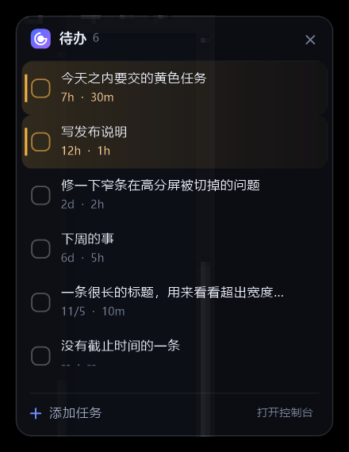

# GoGoSpot

Windows 本机待办清单，单个 exe，不到 1 MB。不联网、不注册、不装运行库。

主体是桌面右上角的**悬浮清单**：平时一个圆点，快到点套红圈、抽出窄条，点开就是清单。
浏览器里的页面叫**控制台**，负责批量整理，平时可以一直关着。

## 跑起来

双击 `GoGoSpot.exe`，右上角出现圆点，端口从 8765 起找空闲的。控制台**不会**自动打开——
悬浮清单就是主界面；只有在设置里把它关掉之后，启动才开浏览器。服务、悬浮清单、托盘图标
在同一个进程里，不弹命令行窗口，任务栏也看不到；重复双击不会开第二份，退出走托盘右键。
需要 64 位 Windows 7 或更高，`web` 和 exe 放在同一层。

单击托盘图标：把悬浮清单叫到前台、摊开并压到最上层，2 秒没交互就收回，收回后恢复原样。

参数：`--no-browser` 不自动开浏览器，`--port 8800` 指定端口，`--data D:\todo.json` 换数据
文件。`--data` 会把设置和备份一起搬过去，配合 `--port` 能开互不干扰的多个实例；这样起的
副本不碰开机启动项。

## 悬浮清单



挂在桌面上，默认不置顶，`Win+D` 回桌面才看得见。圆点外那圈颜色是紧急程度（红 / 黄 / 紫），
鼠标停上去才涨大；窄条写最急的那条和剩余时间，有红色任务时一直挂着。圆点按屏幕大小放大
（1080p 1.1 倍、4K@100% 2.0 倍），展开后的面板不跟着放大。

窄条和圆点环里放哪条：有红色 → 红色里正在做的那条（多条比进度），都没在做才按截止挑最近；
没有红色 → 进度最多的；都没在进行 → 最早结束的。这条只管单槽位，跟列表怎么排是两回事。

列表的顺序两个界面共用一套：**置顶的在最前面，其余按截止时间，没设截止的垫底**。

### 正在进行

每条任务右边有个“正在进行”按钮，鼠标停在行上才显形。点下去变成“停止进行”（常显），整行
底色从左往右铺开表示进度，铺在最底层，文字、勾选框、暖色竖条和按钮都压在它上面。

- 预计最晚开始 = 截止 − 预计用时
- 起始时间 = min(点下去的时刻, 预计最晚开始)
- 用时占比 = (现在 − 起始时间) ÷ 预计用时

进度色按占比分档：≤60% 绿、≤80% 黄、再往上红，只在跨过 60% 和 80% 那一刻播过渡。可以同时
有好几件事在进行中，勾选完成会自动停掉。没设预计用时的算不出占比：行内固定六成紫色，圆点
环和胶囊环改成一整圈紫色呼吸。

### 添加与整理

底栏“添加任务”点一下，面板往上拉出：输入框 + 截止（今天 / 明天 / 后天 / 自选 / 不设）+
预估（10 分到 1 天）+ 从这里开始。自选会翻出月历，能挑到分钟；回车提交，Esc 放弃。

“从这里开始”挂链接或本地文件（系统选择框 / 剪贴板粘贴），一条任务能挂多个；挂了材料的行
标题变成强调色，点整行一起打开。右键某条任务可以“置顶”“推迟一天”或“删除”，右键空白处是
自己的菜单。圆点和窄条都能按住拖动，轻点一下还是展开。

## 控制台

批量改、搜索、翻备份都在这里。添加、勾选、置顶（行尾的图钉）、改名、删除（带撤销）；标签、
搜索、四个视图；两套主题（[浅色](docs/screenshot-light.png) / [深色](docs/screenshot-dark.png)）；
`Enter` 添加、`/` 搜索、`N` 聚焦输入框；备份能导出导入 JSON，也能从历史备份恢复。

排序、进度、正在进行、从这里开始跟悬浮清单同一套规则；差别只有“从这里开始”：浏览器拿不到
绝对路径，只能手填、点“粘贴”读剪贴板，或者从资源管理器拖进来。

**重复任务**在截止面板里选：每天 / 每星期 / 每两星期 / 每月。重复必须有截止——选重复时
自动把截止定在今天 23:59，清掉截止也会清掉重复。完成或逾期时复制一条到下一个时间点，
原任务的重复标记清空，同一期只派生一次；逾期很久的只补一条，下一期直接推到今天之后。

## 设置与数据

控制台右上角齿轮：**开机自动启动**写 `HKCU\...\Run\GoGoSpot`，值是当前 exe 的完整路径，
每次启动重写，exe 挪了位置也能对上；关掉时只删指向自己的那条，`--data` 起的副本不碰。
**悬浮清单**关掉就整个隐藏；**悬浮清单置顶**压在所有窗口上面，前台是全屏程序时自动躲开。

`data/tasks.json` 存任务，`data/backups/` 是每次覆盖前的快照（最多 40 份），
`data/settings.json` 存设置。写入先写临时文件再原子替换，进程被杀也不会留下半截文件。
跟功能相关的字段：`links`（从这里开始）、`startedAt`（进行中，毫秒）、`pinned`（置顶）、
`repeat`（daily / weekly / biweekly / monthly）。服务端每 20 秒扫一次逾期。

## 目录与编译

```
src/    服务端、悬浮清单、程序外壳
web/    控制台，磁盘直读，改完不用重编
icons/  图标源文件
docs/   README 用的截图
tests/  发布前冒烟脚本
```

MinGW-w64（g++ 8.1 以上）或任何支持 C++17 的 Windows 编译器：

```
mkdir build
windres -I src -I icons -i src/app.rc -o build/app.res.o -O coff
g++ -std=c++17 -O2 -static -mwindows -o GoGoSpot.exe ^
    src/main.cpp src/server.cpp src/widget.cpp build/app.res.o ^
    -lws2_32 -lwinhttp -lgdiplus -lgdi32 -luser32 -lshell32 -lole32 -limm32 -lcomdlg32
```

`-static` 把运行时链进去，`-mwindows` 去掉命令行窗口。编译前先退出正在运行的程序。

## HTTP 接口

服务端托管 `web/`、读写 JSON、管备份。`/api/toggle`、`/api/add`、`/api/snooze`、`/api/remove`、
`/api/start`、`/api/pin` 会解析 JSON，保留未知字段只改一两个；其余原样透传。

| 方法 | 路径 | 说明 |
|---|---|---|
| GET | `/api/health`、`/api/info` | 存活探测 / 数据路径、版本、运行时长 |
| GET / POST | `/api/settings` | 读写三个开关，body 形如 `{"topmost":true}` |
| GET / PUT | `/api/tasks` | 读任务；覆盖写入（写前备份），body 必须是带 `tasks` 数组的对象 |
| GET | `/api/widget` | 悬浮清单用，纯文本，一行一条未完成任务 |
| POST | `/api/toggle?id=`、`/api/start?id=&on=` | 翻转完成 / 标记或取消正在进行 |
| POST | `/api/pin?id=&on=` | 置顶 / 取消置顶 |
| POST | `/api/add?title=&due=&estimate=&links=` | 加一条任务，后三个可省，links 用竖线分隔 |
| POST | `/api/open?url=`、`/api/snooze?id=`、`/api/remove?id=` | 打开链接 / 推迟一天 / 删除 |
| GET | `/api/export`、`/api/backups` | 下载当前数据 / 列出历史备份 |
| POST | `/api/backup`、`/api/restore`、`/api/deletebackup` | 备份 / 恢复 / 删备份 |

## 限制

- 只有 Windows。Win32 加 GDI+，换平台基本等于重写。
- 没有同步，多台机器共用得自己拷 `data`。
- 到点不弹系统通知，只有悬浮清单上标红标黄。
- 只监听 127.0.0.1；请求体只认 `Content-Length`（不支持 `chunked`），单次最大 16 MB；
  写接口校验 `Origin` / `Sec-Fetch-Site` / `Host`，别的网页借浏览器改不了任务。

## 许可

MIT，见 [LICENSE](LICENSE)。
