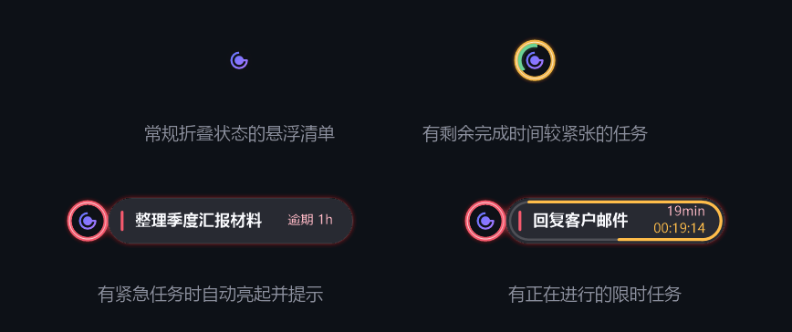
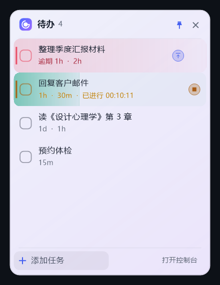
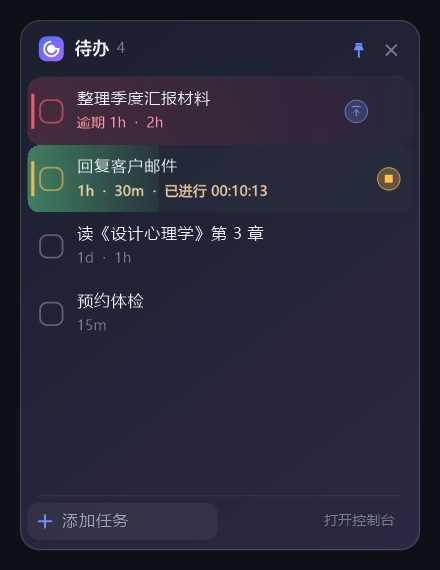
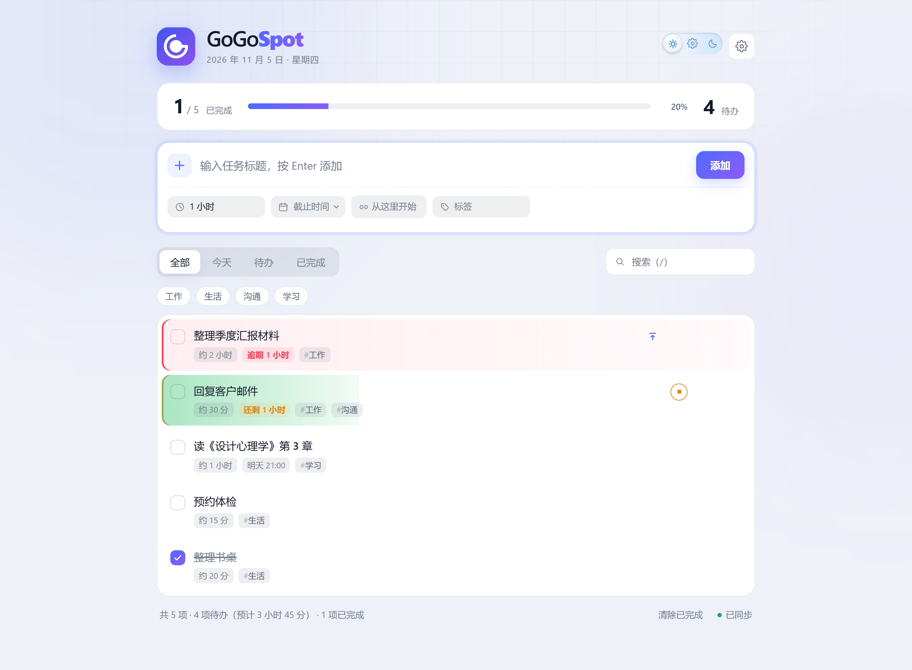
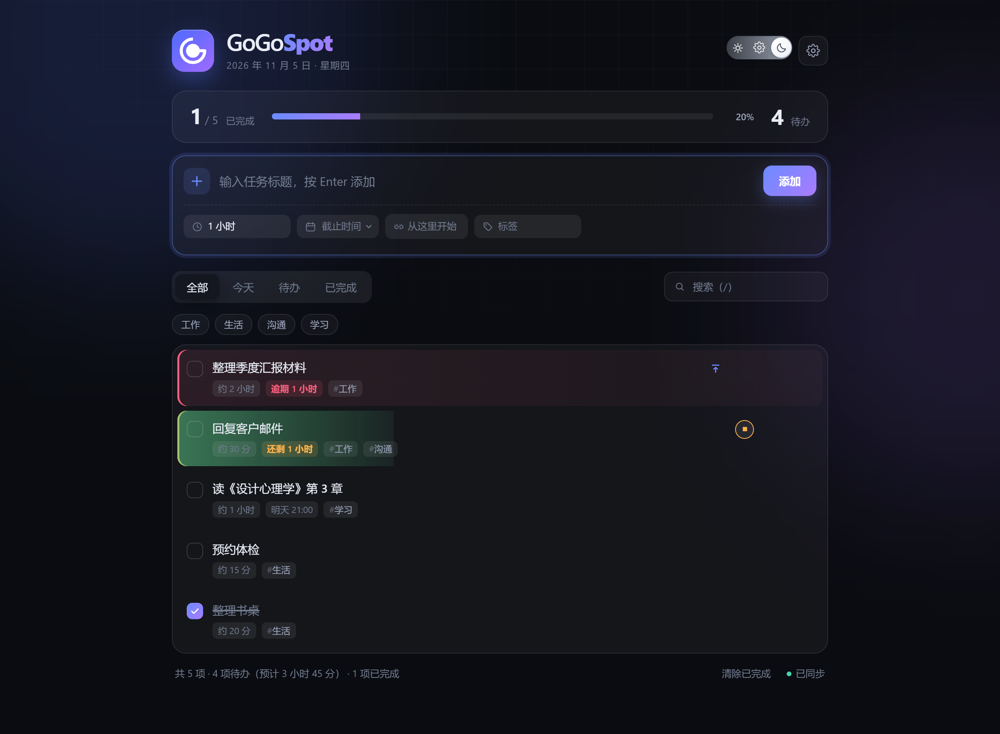

# GoGoSpot

Windows 本地运行的**超轻量级**待办清单管理器，体积不足 1 MB。
不联网、不注册、无需装运行库。

## 运行

将 `GoGoSpot.exe` 与 `web` 文件夹置于同一目录即完成部署。
双击 `GoGoSpot.exe` 启动，托盘图标右键退出。需要 64 位 Windows 7 或更高。

## 悬浮清单

桌面上的任务提示器，有**始终置顶**与**静默于桌面底层**两种状态。
常态下尽量保持低调，任务临近截止时才亮起提示。

并且有折叠状态和展开状态，最低调的折叠状态下，将缩小到几乎不可能抢占视觉焦点。

折叠状态下的悬浮清单在有**紧急任务**或**计时任务**时仍然会通过样式变化来提高醒目程度。



展开后的悬浮清单提供了更丰富的任务管理功能，并且有**日间**和**夜间**两种主题模式。

| 日间 | 夜间 |
|---|---|
|  |  |

### 正在进行

每个任务均可设置预估用时。点击任务右侧的“正在进行”按钮，悬浮清单即以进度条形式显示已进行的时间，可用于考试自测一类的倒计时场景。

- 最晚开始时间点 = 截止时间点 − 预估用时
- 起始时间点 = min(点击“正在进行”按钮的时刻, 最晚开始时间点)
- 用时占比 = (当前时间点 − 起始时间点) ÷ 预估用时

可同时进行多项任务，勾选完成会自动结束计时。用时占比达到 100% 时会发送系统通知。

### 紧急程度

截止时间只说明什么时候要，紧急程度还要看这之前排了多少活。

- **红**：已逾期，或剩余时间不足 min(本任务预估 + 30 分钟, 12 小时) 时
- **黄**：剩余时间不足黄线时。黄线参考但不等同于该截止时刻之前所有任务的累计预估时间
- 单条预估超过 24 小时的减半，视为已含休息计划

### 从这里开始

**从这里开始**用于记录与任务相关的文件、文件夹地址或网址，一条任务可挂多个，点击任务时一并打开。

把材料挂在任务上，就不必为了记住它们而常开浏览器标签页或文件管理器窗口。

## 控制台页面

浏览器中的管理页面，用于批量修改、搜索与备份恢复。

| 日间 | 夜间 |
|---|---|
|  |  |

主题分日间、夜间、跟随系统三档，控制台页面与悬浮清单同步切换；
跟随系统取 Windows 的应用模式，与系统的浅色/深色设置一致。

**重复任务**在截止面板中选择：每天 / 每星期 / 每两星期 / 每月，且必须有截止时间；
完成或逾期后自动生成下一期。

## 设置与数据

设置面板在控制台页面右上角，数据默认放在 exe 同级的 `data/` 目录。

| 项 | 位置 | 说明 |
|---|---|---|
| `tasks.json` | `data/` | 任务数据 |
| `settings.json` | `data/` | 设置：`widget` / `topmost` / `autostart` / `themeMode` |
| `backups/` | `data/` | 每次覆盖前的快照，上限 40 份 |
| `links` | 任务字段 | 关联材料 |
| `startedAt` | 任务字段 | 进行中，毫秒时间戳 |
| `pinned` | 任务字段 | 置顶 |
| `repeat` | 任务字段 | `daily` / `weekly` / `biweekly` / `monthly` |
| `route_origin_date` | 任务字段 | 循环锚点 |

## 目录与编译

```
src/main.cpp        程序外壳与托盘
src/server.cpp      后台编译入口，聚合 src/server/*.inc
src/server/         按职责命名的后台片段：文件系统、JSON、设置、HTTP、路由与任务
src/widget.cpp      悬浮清单编译入口，聚合 src/widget/*.inc
src/widget/         按职责命名的悬浮清单片段：布局、状态、绘制、命中检测与交互
web/                控制台页面，磁盘直读，改完不用重编
icons/              图标源文件
docs/               README 用的截图
tests/              发布前冒烟脚本
```

`server.cpp` 与 `widget.cpp` 按功能顺序包含对应 `.inc` 片段；片段保持在原编译单元中，以保留 `static` 符号的内部链接。

MinGW-w64（g++ 8.1 以上）或任何支持 C++17 的 Windows 编译器：

```
mkdir build
windres -I src -I icons -i src/app.rc -o build/app.res.o -O coff
g++ -std=c++17 -O2 -static -mwindows -o GoGoSpot.exe ^
    src/main.cpp src/server.cpp src/widget.cpp build/app.res.o ^
    -lws2_32 -lwinhttp -lgdiplus -lgdi32 -luser32 -lshell32 -lole32 -limm32 -lcomdlg32
```

`-static` 静态链接运行时，`-mwindows` 去掉命令行窗口。编译前需退出正在运行的程序。

## HTTP 接口

后台托管 `web/`、读写 JSON、管理备份，本身不解析任务字段。
仅 `/api/toggle`、`/api/start`、`/api/pin`、`/api/snooze`、`/api/remove`、`/api/add`
会修改 JSON——它们需要保留未知字段、只改其中一两个，因此不能整份覆盖。

| 方法 | 路径 | 说明 |
|---|---|---|
| GET | `/api/health`、`/api/info` | 存活探测 / 数据路径、版本、运行时长 |
| GET / POST | `/api/settings` | 读写三个开关，body 形如 `{"topmost":true}` |
| GET / POST | `/api/theme` | 主题三档，`?mode=light` / `dark` / `system` |
| GET / PUT | `/api/tasks` | 读任务；覆盖写入（写前备份），body 必须是带 `tasks` 数组的对象 |
| GET | `/api/widget` | 悬浮清单用，纯文本，一行一条未完成任务 |
| POST | `/api/toggle?id=`、`/api/start?id=&on=` | 翻转完成 / 标记或取消正在进行 |
| POST | `/api/pin?id=&on=`、`/api/topmost?on=` | 任务置顶 / 悬浮清单置顶 |
| POST | `/api/add?title=&due=&estimate=&links=` | 加一条任务，后三个可省，links 用竖线分隔 |
| POST | `/api/open?url=`、`/api/snooze?id=`、`/api/remove?id=` | 打开链接 / 推迟一天 / 删除 |
| GET | `/api/export`、`/api/backups` | 下载当前数据 / 列出历史备份 |
| POST | `/api/backup`、`/api/restore`、`/api/deletebackup` | 备份 / 恢复 / 删备份 |

## 当前使用限制

- 仅支持 Windows。基于 Win32 与 GDI+，跨平台需重写。
- 无同步机制，多台机器共用需自行拷贝 `data`。
- 仅监听 `127.0.0.1`；请求体只接受 `Content-Length`（不支持 `chunked`），单次上限 16 MB；
  写接口校验 `Origin` / `Sec-Fetch-Site` / `Host`，其他网页无法借浏览器修改任务。

## 许可

MIT，见 [LICENSE](LICENSE)。
